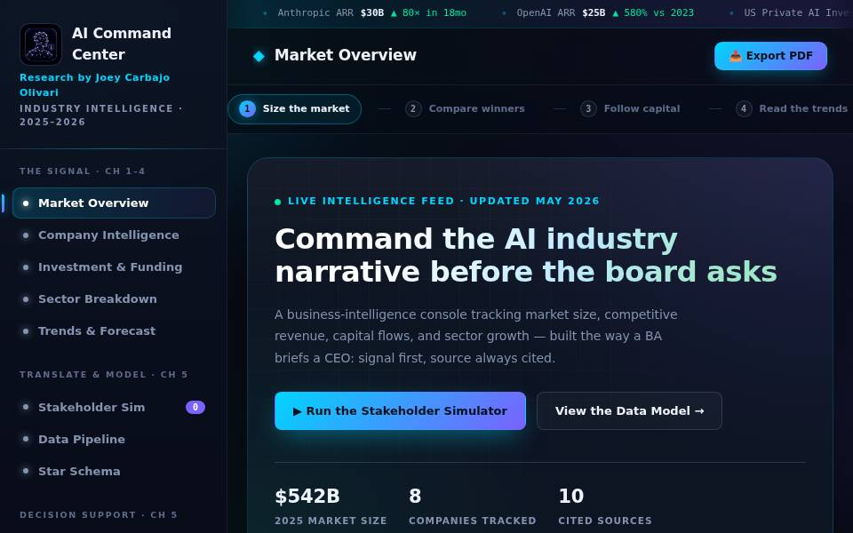
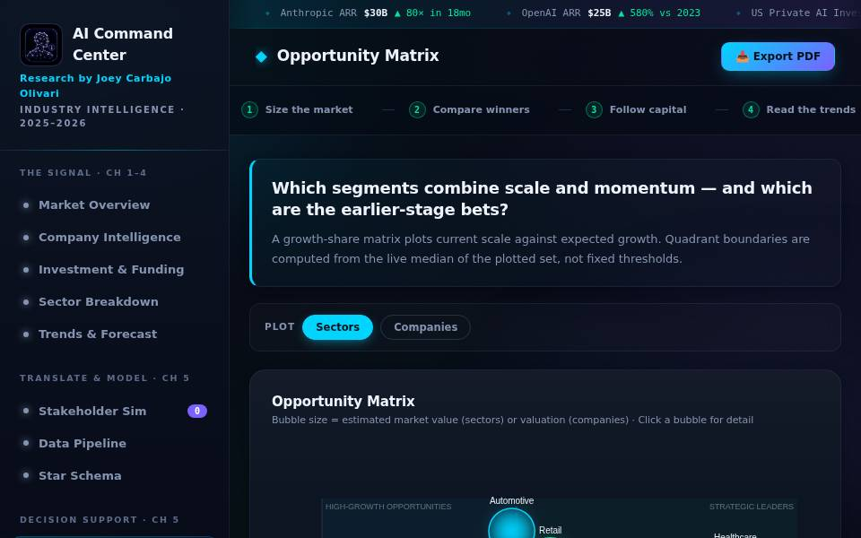
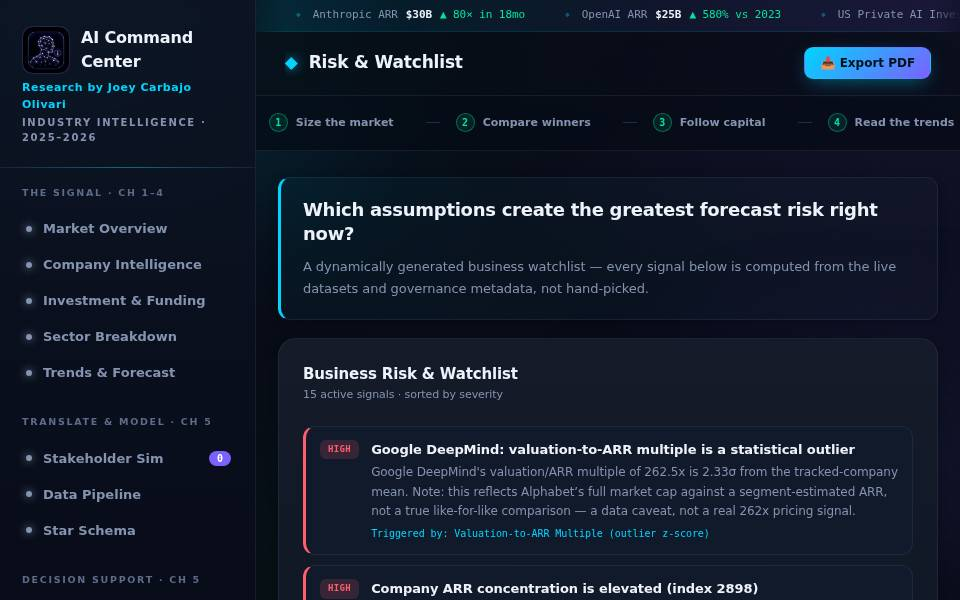

# AI Industry Command Center

A single-page, zero-dependency business-intelligence dashboard that turns public AI-industry data into an executive-ready analysis: KPI design, data modeling, forecasting, risk detection, and stakeholder-driven requirements — built and documented the way a Business/Data Analyst would deliver it to a real stakeholder.

**Live demo:** deployed via GitHub Pages from this repository (see `index.html`).

> This is an analytical **portfolio demonstration**, not a live production data feed and not investment advice. Every figure is tagged as actual, estimated, forecast, or illustrative — see [Data Integrity & Assumptions](#data-integrity--assumptions) below. The author did not work at any of the companies referenced in this project.

---

## Why this project exists

Most "AI market dashboard" portfolio projects stop at charts. This one is built to answer the five questions a real stakeholder actually asks about any number on a dashboard:

1. **What happened?**
2. **Why did it happen?**
3. **Why does it matter?**
4. **What business decision could this support?**
5. **What should the stakeholder investigate or do next?**

Every major section pairs a chart with a compact **"So What?" insight card** (key finding → business implication → recommended action → stakeholder → confidence → supporting KPI), and the dashboard opens with an **Executive Decision Brief** that a recruiter or hiring manager can read in under 30 seconds.

## Screenshots

| Executive Decision Brief | Opportunity Matrix | Risk & Watchlist |
|---|---|---|
|  |  |  |

---

## What this project demonstrates

- **Business analysis & requirements gathering** — the Stakeholder Simulator turns six vague executive requests into scoped KPIs, sources, dimensions, SMEs, and dashboard outputs.
- **KPI design** — 20+ calculated metrics (CAGR, YoY growth, concentration index, valuation multiples, momentum scores, opportunity scores, forecast variance, and more), each documented in a searchable **KPI Dictionary** with formula, purpose, stakeholder, interpretation, and limitations.
- **Data modeling** — a star schema (`Fact_AI_Market_Activity` + 7 dimension tables) and a documented ETL pipeline (source → landing → cleansing → transform → model → dashboard).
- **Executive reporting** — an Executive Decision Brief with three findings, two risks, two opportunities, three recommended actions, and three composite scores (Market Momentum, Investment Attractiveness, Market Risk).
- **Trend & variance analysis** — growth acceleration/deceleration detection, actual-vs-forecast framing, benchmark-to-revenue interpretation.
- **Forecasting** — CAGR-based scenario bands (downside / base / best-case), years-to-double, market maturity classification.
- **Data quality awareness** — a six-dimension Data Quality Scorecard, a full data-governance table (owner, refresh cadence, transformation/validation rules, source conflicts, lineage) per dataset, and a dynamically generated **Risk & Watchlist** panel that flags outliers, concentration risk, and low-confidence estimates directly from the data.
- **Translating data into decisions** — an interactive **Opportunity Matrix** (growth-share bubble chart, click any bubble for supporting metrics + interpretation + action + risk + confidence).

---

## Architecture

Zero build tooling, zero runtime dependencies — plain HTML/CSS/JS, deployable directly to GitHub Pages.

```
index.html                     Single-page app shell — all sections, one HTML file
css/
  base.css                     Design tokens (colors, fonts, radii, shadows)
  components.css               Core component styles (cards, KPIs, tables, nav…)
  insights.css                 Executive Brief, So-What cards, Watchlist, Opportunity
                                Matrix, KPI Dictionary, Data Governance, DQ Scorecard
  layout.css / responsive.css  Grid layout + mobile breakpoints
  hero.css / print.css / …     Supporting styles
js/
  data/
    appData.js                 Raw datasets + data-governance metadata (source, owner,
                                refresh cadence, confidence, value type, lineage)
    calc.js                    Pure, reusable KPI calculation engine (CAGR, YoY,
                                concentration index, momentum score, etc.) — no DOM code
    kpiDictionary.js            KPI Dictionary content + search/render
  features/
    downloads.js                CSV + data-dictionary export
    simulator.js                Stakeholder Requirements Simulator
    insights.js                 Executive Decision Brief, So-What cards, Watchlist,
                                 Data Governance rendering — computed from calc.js
    opportunityMatrix.js        Growth-share bubble chart + click-through detail panel
  app.js                        Navigation, canvas chart rendering, section wiring
vendor/anthropic-skills/        Optional vendored Anthropic Agent Skills (see
                                ANTHROPIC_SKILLS.md)
```

**Design principle:** raw data, calculated metrics, and DOM rendering are kept in separate files. `calc.js` has no DOM references and can be unit-tested in isolation; `insights.js` and `opportunityMatrix.js` call into it rather than duplicating formulas; `index.html` never hardcodes a number that `calc.js` can compute from `appData.js`.

---

## Feature map

| Section | What it answers |
|---|---|
| **Market Overview** (+ Executive Decision Brief) | Where is the AI market expanding fastest, and what should leadership do about it right now? |
| **Company Intelligence** | Which companies combine scale *and* momentum — not just who has the biggest ARR? |
| **Investment & Funding** | Where is capital concentrating, and is it outrunning measured market demand? |
| **Sector Breakdown** | Which industries offer the strongest growth-share opportunity? |
| **Trends & Forecast** | Are capability gains (benchmarks) translating into commercial value? |
| **Stakeholder Simulator** | Can you turn a vague executive request into scoped KPIs, sources, and a dashboard? |
| **Data Pipeline & Governance** | How do we know these numbers can be trusted? Full source-to-KPI-to-chart lineage, a 6-dimension Data Quality Scorecard, and per-dataset governance (owner, refresh cadence, transformation/validation rules, conflict resolution). |
| **Star Schema** | How is this data modeled for repeatable analysis? |
| **Opportunity Matrix** | Which segments (sectors or companies) are Strategic Leaders, High-Growth Opportunities, Mature/Defensive, or Lower-Priority — computed from live medians, not fixed thresholds? |
| **Risk & Watchlist** | Which assumptions carry the greatest forecast risk right now — dynamically generated from outlier detection, concentration indices, and governance metadata? |
| **KPI Dictionary** | What does each metric mean, how is it calculated, and what are its limitations? |
| **Download Center** | Export every dataset as CSV plus a full data dictionary — for anyone who wants to verify or extend the analysis. |

---

## KPI formulas

All formulas live in `js/data/calc.js` as pure functions and are documented per-KPI (with worked examples) in the in-app **KPI Dictionary**. Summary:

| KPI | Formula |
|---|---|
| Year-over-Year Growth | `(Current − Previous) / |Previous| × 100` |
| CAGR | `(End / Begin)^(1/Years) − 1 × 100` |
| Years to Double | `ln(2) / ln(1 + CAGR)` |
| Concentration Index (HHI-style) | `Σ(share_i²)` across participants |
| Top-N Share | `Sum(top N) / Sum(all) × 100` |
| Valuation-to-ARR Multiple | `Valuation / ARR` |
| Company Momentum Score | `70% × min(YoY / peerMaxYoY, 1) + 30% × min(ARR / peerMaxARR, 1)`, scaled to 100 |
| Competitive Gap from Leader | `(Value − LeaderValue) / LeaderValue × 100` |
| Outlier Detection | z-score: `(Value − Mean) / StdDev`, flagged at \|z\| ≥ 1.5 |
| Opportunity Score (growth-share) | `60% × min(CAGR/maxCAGR,1) + 40% × min(Share/maxShare,1)`, scaled to 100 |
| Growth-Share Quadrant | Median-based classification into Strategic Leader / High-Growth Opportunity / Mature-Defensive / Lower-Priority |
| Forecast Variance | `(Actual − Forecast) / |Forecast| × 100` |
| Scenario Band | Base value compounded at `CAGR ± spread` over N years |
| Data Confidence Score | Average of six Data Quality Scorecard dimensions (completeness, accuracy, consistency, timeliness, validity, uniqueness) |

All functions are defensive against `null`, `undefined`, zero, and non-numeric inputs — where a metric cannot be responsibly calculated, the UI shows **"Insufficient data"** instead of a fabricated number.

---

## Data integrity & assumptions

Every dataset carries a governance record (visible on the **Data Pipeline & Governance** page) with:

- **Source system** and **as-of date**
- **Value type**: actual / estimated / forecast / illustrative
- **Confidence**: high / medium / low
- **Transformation, validation, missing-value, duplicate, and outlier handling rules**
- **Known source conflicts** and how they were reconciled
- **Lineage**: source → raw landing → transformation → star schema → KPI → chart

Composite scores (Market Momentum, Investment Attractiveness, Market Risk, Company Momentum, Opportunity Score) are **illustrative, documented composites** built for this portfolio project — their weights are stated explicitly in the KPI Dictionary and in each score's "methodology" tooltip. They are not published industry indices.

**Known limitations worth flagging on review:**
- Google DeepMind's valuation-to-ARR multiple uses Alphabet's full market capitalization against a segment-estimated ARR — it is flagged on the Watchlist as a data caveat, not a genuine 262x pricing signal.
- China AI investment figures are the least reliable series in the dataset (state-fund non-disclosure).
- 2025 investment figures and all post-2025 market-size figures are forecasts, not actuals.
- Long-range market-size years (2027, 2029, 2031–2033) are intentionally left blank rather than interpolated.

---

## Running locally

No build step. Any static file server works:

```bash
python3 -m http.server 8000
# open http://localhost:8000
```

or simply open `index.html` directly in a browser (some browsers restrict `file://` fetches, but this app has no fetch calls — all data is inlined in `js/data/appData.js`).

## Deployment

Static GitHub Pages deployment — no build step required. `.nojekyll` is present so Pages serves the repository as-is.

## Optional: Anthropic Agent Skills

This repo can optionally vendor Anthropic's Agent Skills for use with Claude Code (see `ANTHROPIC_SKILLS.md`):

```bash
bash scripts/sync-anthropic-skills.sh
```

---

## Tech notes

- No frameworks, no bundler, no npm dependencies. Charts are hand-rolled on `<canvas>`.
- Keyboard-accessible navigation and interactive elements; `prefers-reduced-motion` respected for chart transitions.
- Mobile-responsive down to ~360px width; horizontal scroll is intentional only for the ticker marquee and the chapter-rail step nav.
- CSV export and a full plain-text data dictionary are available from the Download Center, generated client-side from the same `appData.js` source of truth used by the charts (no duplicated hardcoded values).
